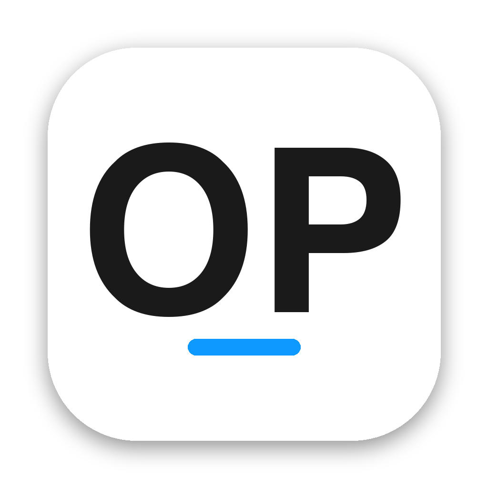
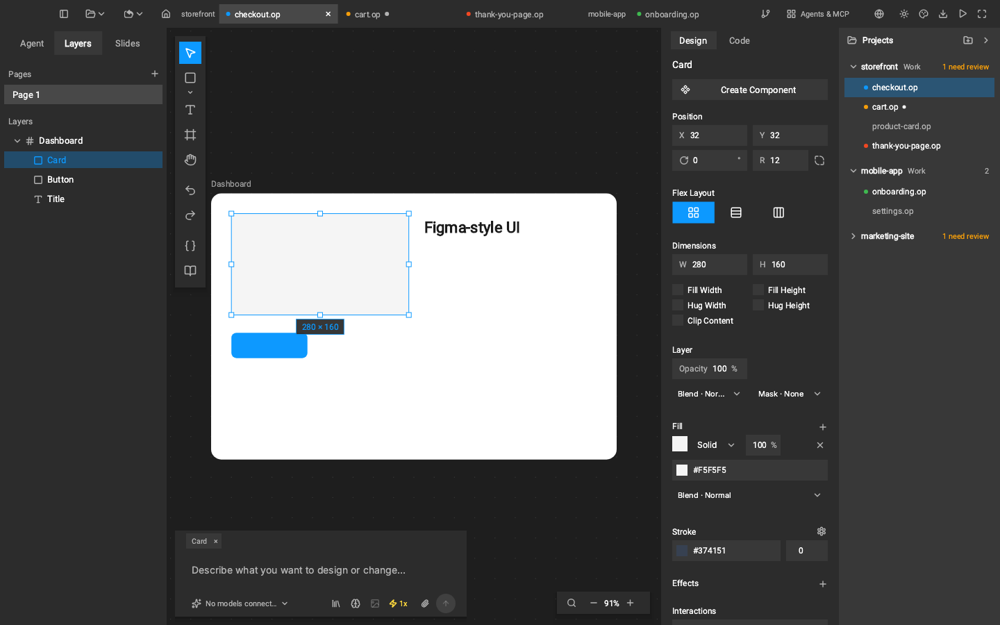

<p align="center">
  
</p>

<h1 align="center">OpenPencil</h1>

<p align="center">
  A vector design editor written in Rust, where the design is a plain <code>.op</code> JSON file
  and an AI agent can edit it from inside the app or from outside over MCP.
</p>

<p align="center">
  
</p>

<p align="center"><sub>Screenshot taken before the active-file info bar replaced the tab strip in the top bar.</sub></p>

This repository is a fork of [OpenPencil by ZSeven-W](https://github.com/ZSeven-W/openpencil) (MIT). The product name is unchanged. It is built from source and runs **local-only** (see [Status and limits](#status-and-limits)).

## What it is

- A native desktop editor (winit + Skia/GL) and a browser editor (wasm + CanvasKit), both driven by one Rust core. The UI toolkit is the `jian` Skia/widget library in `vendor/jian`.
- Documents are `.op` files (JSON). The editor also opens legacy `.pen` files and imports `.fig` and HTML.
- Design is done by hand on the canvas, by chatting with the built-in design agent, or by any MCP-capable agent that connects to the editor.

## What it does today

Each item below is taken from `CLAUDE.md` / `crates/CLAUDE.md` or from the source, and applies to the desktop app unless it says otherwise.

### Working with many files

- **Several documents open at once** as tabs in one window. `Cmd+1..9` and `Cmd+W` switch and close them. Every open path (menu, Finder, drag-and-drop, a second launch) opens a document; a file that is already open is switched to instead.
- **Info bar** in the top bar shows the active file: `project > folder > file`, save state, Git branch, a chip for other unsaved documents, an agent indicator when a run is in another tab, and a page switcher for documents with two or more pages.
- **Projects dock** on the right is the file navigator. A project is the nearest folder with a `.git` / `package.json` marker; opened folders are listed too (`*.op` and `*.fig` rows). It supports rename, "Move to Trash" (macOS), new design, and follows changes on disk.
- **Quick switcher** on `Cmd+K`: fuzzy match over open documents, project files and project names.
- **Agent runs belong to a document.** A run only touches the document it was started in, and keeps running while you work in another tab. **Revert Last Agent Run** (Edit menu) restores the document as it was before the last run in one undo step.
- **Safety net.** Dirty documents are snapshotted to a recovery folder and offered for recovery after a crash. Autosave after a successful agent run is on by default and can be switched off in Settings > System. Autosave is not periodic.

### Designing with agents

- **Built-in design agent** in the chat panel, plus external CLI agents that connect over MCP: Claude Code, Codex, OpenCode, Kiro, Copilot, Antigravity, Grok Build (Settings > MCP).
- **MCP server** (`--mcp`, `--mcp-http`, or live inside the desktop app). The full catalog has **144 tools** (`TOOL_SCHEMAS`, pinned by an exact-count test), plus one `insert_<component>` tool per built-in UI kit component. A **lean profile** with six tools (`get_editor_state`, `get_guidelines`, `batch_design`, `snapshot_layout`, `get_screenshot`, `finalize_design`) is available with `--mcp-profile lean` or the `/mcp/lean` path.
- **Write-time feedback.** Write tools report layout, icon, contrast, structure and font problems in the same result, and `finalize_design` returns a pass / warn / fail verdict.
- **Style control.** A `design.md` file or a pinned style steers a run. When neither exists, the composer suggests styles for a new-design prompt (77 style records); picking one applies to the next run only.
- **Design data lookup.** `get_guidelines { category: "data" }` searches two embedded tables of product-type records (a small seed written for this project and 191 records imported from UI UX Pro Max, MIT, pinned commit) and 77 style definitions. Results are reference data capped at 6 KB; a weak match returns nothing.
- **Usage meter** for design runs: token counts for the last run, shown for Anthropic models only.
- **Offline eval harness** (`op-smoke`): ten scripted design fixtures are replayed without a model and compared exactly with a stored baseline. It checks the code behind the tools, not skill or prompt wording.

### Assets

- **Free image providers** with a licence policy. Openverse, Wikimedia Commons and Iconify need no key; Pixabay and Unsplash use your own key (Unsplash is off by default). CC0 and public domain are accepted, CC BY is accepted with credit, NC / ND / share-alike / unknown are refused. The credit is stored on the node, and **File > Copy image credits** copies one line per credit.
- **Missing fonts** are downloaded automatically (desktop, setting on by default) from the Fontsource catalog, only for families with an OFL, Apache or UFL licence; licences are saved next to the fonts.
- **Icons**: the embedded Iconify catalog (Lucide and Feather) draws any real icon name; a near-miss name is auto-corrected and reported.

### Formats, code and embedding

- **Import**: `.fig` (converted to a new `.op`, the original is never touched), HTML (file or URL), SVG, images; `.pen` opens directly. Whole-document imports never replace work in progress: they use an empty untitled tab or open a new one.
- **Code export** (`op codegen:export`, deterministic, no model): `react`, `react-tailwind`, `vue`, `svelte`, `html`, `flutter`, `swiftui`, `compose`, `react-native`, `css-variables`. Image, PDF, PPTX and HTML-deck export are in the `op export*` commands.
- **CLI `op`**: starts the editor (`op start`, `--web`, `--headless`), calls any MCP tool, and has shortcuts such as `op design`, `op insert`, `op import:figma`, `op import:html`, `op styles`, `op templates`. Full list: [`crates/op-cli/src/usage.txt`](./crates/op-cli/src/usage.txt).
- **Web viewer SDK**: `packages/op-web-sdk` is a read-only `.op` viewer backed by the same wasm renderer, with React and Vue adapters in `packages/op-web-sdk-react` and `packages/op-web-sdk-vue`.
- **Other packages in the tree**: a Chrome extension that imports the rendered active tab, and a VS Code extension (`packages/op-chrome-extension`, `packages/op-vscode`).
- **Interface languages**: 15 locales ship in the app.

## Build and run

Prerequisites: the Rust toolchain pinned in [`rust-toolchain.toml`](./rust-toolchain.toml) (`rustup` installs it on first use, including the `wasm32-unknown-unknown` target). Bun and Node.js are needed only for the web SDK under `packages/`. The browser bundle script also needs `wasm-bindgen`, `wasm-opt`, `node`, `python3` and `gzip` (see the header of [`tools/check-wasm-bundle.sh`](./tools/check-wasm-bundle.sh)).

```bash
git clone --recurse-submodules https://github.com/baroned1707/openpencil.git
cd openpencil
# Already cloned without submodules:
git submodule sync --recursive && git submodule update --init --recursive
```

Three submodules live in `vendor/`: `jian` (this fork's `openpencil-custom` branch), `casement` (winit fork) and `agent` (agent runtime). The last two are still fetched from the upstream author's repositories, as set in [`.gitmodules`](./.gitmodules). `vendor/anthropic-agent-sdk` is tracked in-tree.

```bash
cargo build --workspace --release        # everything
cargo run -p op-host-desktop --release   # desktop app (binary: openpencil-desktop)
cargo build -p op-cli --release          # CLI (binary: op, in target/release/)
bash scripts/start-web-rust.sh           # browser editor: builds the wasm bundle and the web server (default 127.0.0.1:3100)
```

Checks used in this repository:

```bash
cargo test --workspace                   # op-host-native also needs --features gl-host to run its widget tests
cargo check --workspace
cargo clippy --workspace --all-targets -- -D warnings
cargo fmt --all
cargo check --target wasm32-unknown-unknown -p op-host-web --no-default-features --features web
```

Web SDK tooling runs from `packages/`: `bun run lint`, `bun run format`.

### macOS app bundle

```bash
cargo build -p op-host-desktop --release
tools/pinned-release-tools.sh cargo-cli cargo-bundle target/cargo-bundle-host   # stages the pinned cargo-bundle the script requires
bash scripts/bundle-macos.sh             # target/release/bundle/osx/OpenPencil.app
bash scripts/install-macos.sh package    # zip + dmg + sha256 under target/dist
bash scripts/install-macos.sh install    # backs up the installed app, then installs the new one
bash scripts/install-macos.sh list       # list backups; `revert` puts one back
```

The bundle script signs ad hoc unless `MACOS_SIGN_IDENTITY` is set. Read the header of each script for its environment variables.

## Status and limits

- **Local-only.** The `op-auth-bridge` crate's `local-only` feature is on by default. It hides account and collaboration chips, Home sign-in, the Account settings tab and every collaboration action. The code is not deleted; the backend is restored by building `op-auth-bridge` with `--no-default-features`. Collaboration and any account-based service of the original project are therefore not available in this build.
- **Still goes online:** the update check (`api.github.com`), model probing, Iconify, the image providers you enable, and the font download. Chat and design runs talk to the model provider or CLI agent you configure.
- **Platforms.** The macOS scripts above are the only packaging path described here. Packaging files and CI workflows for Windows, Linux (`.deb`, AppImage), Android, iOS and OpenHarmony exist in `packaging/` and `.github/workflows/`, but builds on those platforms have not been verified for this fork. [`docs/build_windows/BUILD_WINDOWS.md`](./docs/build_windows/BUILD_WINDOWS.md) is inherited from upstream and has not been re-checked.
- **Not done:** several agents on one document (sub-agents run one after another), multiple documents in the browser editor, touch input, several concurrent collaboration sessions.
- **Not verified against a real model:** the skill text and prompts of the design agent. The offline eval pins the tool behaviour and the prompt size, not the quality of a model's output.
- **No release channel is documented.** Build from source.

## Project layout

| Path | Contents |
| --- | --- |
| `crates/` | Rust workspace: editor core, widgets, hosts (desktop, web, mobile), MCP, agents, codegen, importers, CLI. Map: [`crates/CLAUDE.md`](./crates/CLAUDE.md) |
| `packages/` | Web viewer SDK (`op-web-sdk`, React and Vue adapters), Chrome and VS Code extensions. [`packages/CLAUDE.md`](./packages/CLAUDE.md) |
| `vendor/` | `jian` (UI toolkit), `casement` (winit fork), `agent` (agent runtime), `anthropic-agent-sdk` |
| `scripts/`, `tools/` | Build, bundle, install and check scripts |
| `packaging/` | Desktop, mobile and shared packaging files and third-party notices |
| `RELEASE_NOTES/` | Release notes inherited from upstream up to v0.8.5 |

Coding conventions and the commit format are in [`CLAUDE.md`](./CLAUDE.md).

## License

[MIT](./LICENSE).

Based on OpenPencil by ZSeven-W (MIT): <https://github.com/ZSeven-W/openpencil>.

Third-party components and data sets are listed with their licence texts in [`packaging/shared/THIRD_PARTY_NOTICES.md`](./packaging/shared/THIRD_PARTY_NOTICES.md). The desktop app opens them from **File > Third-party notices**.
